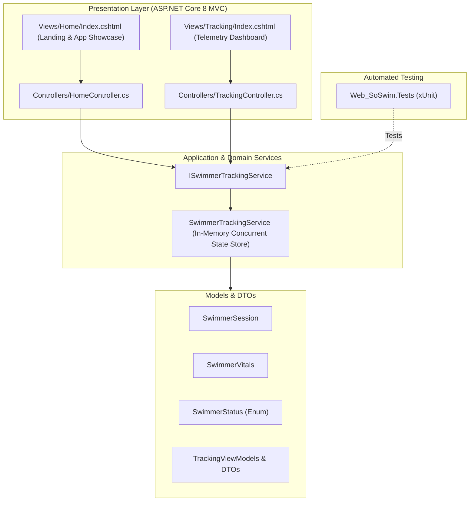

# SOSWIM Architecture

## 1. Clean Layered Architecture (ASP.NET Core 8)

The project strictly follows layered clean architecture separation:

## 2. Technology Stack & Key Highlights
- **Framework**: .NET 8.0 (C# 12).
- **Architecture**: MVC with decoupled Service Layer.
- **State Management**: Concurrent In-Memory Session Cache (`ConcurrentDictionary`), structured so it is 100% plug-and-play ready for Entity Framework Core / Supabase PostgreSQL migrations in subsequent stages.
- **Testing**: xUnit with 100% pass rate on business rules (especially the 50% risk threshold gatekeeper).
- **Design Craftsmanship**:
  - Pure vector Lucide SVGs (Zero emoji clutter).
  - High-contrast marine navy & electric cyan palette (`#050b14`, `#00e5ff`, `#0284c7`).
  - Native RTL layout with Tajawal typography for optimal Arabic user experience.
